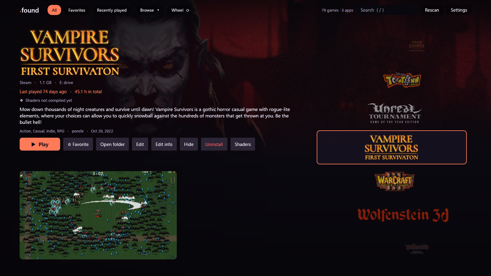

<p align="center">
  
</p>

<h1 align="center">dotFound launcher</h1>
<p align="center"><em>every game you forgot you had.found.</em></p>

<p align="center">
  A clean, fast game launcher that finds every game on your PC — Steam, GOG, Epic, Xbox, Battle.net,
  installers, portable folders, recompiled and decompiled ports — dresses each one in real artwork,
  and puts them all on one shelf.
</p>

<p align="center">
  <a href="https://github.com/Joshspeakman/dotfound/releases/latest"><b>Download the latest release</b></a>
  &nbsp;·&nbsp; <a href="#install-from-the-command-line">Command line</a>
  &nbsp;·&nbsp; <a href="#platforms">Platforms</a>
  &nbsp;·&nbsp; <a href="LICENSE.txt">License</a>
</p>

<p align="center"></p>

> **Alpha.** dotFound 0.1 is an early release. It's stable in daily use on Windows; Linux is new and
> macOS is in testing. Please report anything odd in [Issues](https://github.com/Joshspeakman/dotfound/issues).

## Download

| System | Download | |
|---|---|---|
| **Windows 10 / 11** (x64) | [**dotFound-Setup.exe**](https://github.com/Joshspeakman/dotfound/releases/latest/download/dotFound-Setup.exe) | Installer for your user, no admin needed |
| Windows, portable | [dotFound-windows-x64.zip](https://github.com/Joshspeakman/dotfound/releases/latest/download/dotFound-windows-x64.zip) | Unzip anywhere, run `dotFound.exe` |
| **Linux** (x86_64) | [dotFound-linux-x86_64.tar.gz](https://github.com/Joshspeakman/dotfound/releases/latest/download/dotFound-linux-x86_64.tar.gz) | Ubuntu 22.04+, Debian 12+, Fedora 36+, SteamOS, or any distro with glibc 2.35+. Or use the one-line install below |
| **macOS** | Coming in this alpha | Watch the [releases](https://github.com/Joshspeakman/dotfound/releases) |

These links always point at the newest release. Every release also lists its files with
[SHA-256 checksums](https://github.com/Joshspeakman/dotfound/releases/latest/download/SHA256SUMS.txt).

**Windows says "Windows protected your PC"?** Alpha builds aren't code-signed yet. Click **More info**,
then **Run anyway**. You can check the download against `SHA256SUMS.txt` first
(`Get-FileHash dotFound-Setup.exe`).

## Install from the command line

**Windows** (PowerShell):

```powershell
irm https://github.com/Joshspeakman/dotfound/releases/latest/download/install.ps1 | iex
```

Set `$env:DOTFOUND_PORTABLE = '1'` first for a portable copy, `$env:DOTFOUND_DESKTOP = '1'` for a desktop
shortcut, or `$env:DOTFOUND_VERSION = 'v0.1.0-alpha.1'` for a specific release. The script checks the
download against the release's checksums before it runs anything.

**Linux** (installs for your user, no sudo; macOS joins when its build is in the release):

```sh
curl -fsSL https://github.com/Joshspeakman/dotfound/releases/latest/download/install.sh | sh
```

Remove it again with `curl -fsSL .../install.sh | sh -s -- --uninstall` (your library is kept).

**With the GitHub CLI**:

```sh
gh release download --repo Joshspeakman/dotfound --pattern 'dotFound-Setup.exe'          # Windows installer
gh release download --repo Joshspeakman/dotfound --pattern 'dotFound-linux-x86_64.tar.gz' # Linux
gh release download --repo Joshspeakman/dotfound --pattern 'SHA256SUMS.txt'               # checksums
```

Silent install for scripts and deployment: `dotFound-Setup.exe /VERYSILENT /SUPPRESSMSGBOXES /CURRENTUSER`
(add `/TASKS=desktopicon` for a desktop shortcut). Uninstall from Settings > Apps, or run
`unins000.exe /VERYSILENT` in the install folder.

## What it does

- **Finds everything.** Steam (including libraries Steam forgot), GOG, Epic, Xbox, Battle.net, the
  Windows uninstall list, portable game folders, and folders you add. One entry per game, even when
  you own it twice: pick which **version** plays.
- **Knows what recomps are.** Recompilations, decompilation ports, source ports and emulated games are
  recognised from the install itself and shown under their own name (Zelda 64: Recompiled, Dusklight,
  Ship of Harkinian…), with the game they bring back, their authors, version and project page.
- **Real artwork for every game.** Covers, backdrops, logos and icons from Steam, GOG, console box art,
  GitHub and SteamGridDB (optional free key) — and when nothing exists, dotFound draws a cover itself.
  Nothing is left blank. ScreenScraper (videos, manuals, more box art) is built in too; in this alpha it
  needs a ScreenScraper developer login entered in Settings, and a built-in one is on the way.
- **Real music only.** A game's theme is its own soundtrack (a Steam soundtrack, the music it ships with,
  or its project's files) — never trailer audio. Or play your own music instead.
- **Four layouts, any window.** Cover flow, Grid, List and Wheel, in four themes and eight accent
  colours. Works at any size and orientation, from a tall portrait screen to a 420 px window.
- **Mouse, keyboard, touch and controllers.** Xbox, PlayStation, Nintendo and generic pads, with the
  right button prompts for the one in your hands.
- **Jump back in.** It opens on the game you played last, with play time from Steam and from dotFound.
- **Smart filters.** Genre, series, platform, era and source.
- **No more shader stutter** (Windows): with [Preheat](https://github.com/Joshspeakman/SCSKiller)
  installed, dotFound offers to compile a game's shaders before you play it.
- **Uninstalls cleanly**, through the game's own uninstaller or launcher, or to the Recycle Bin (the Trash
  on Linux).
- **Light.** Idle, it uses about 0.02% CPU; minimised or while you play, it lets go of its memory.

<p align="center">
  
  
</p>
<p align="center"></p>

## Platforms

| | Windows | Linux | macOS |
|---|---|---|---|
| Steam games | ✔ | ✔ (native and Flatpak Steam) | In testing |
| GOG, Epic, Xbox, Battle.net, uninstall list | ✔ | — (Windows stores) | — |
| Portable folders | ✔ | Native games in `~/Games` and folders you add | In testing |
| Windows `.exe` games outside Steam | ✔ | Through Wine, when installed | — |
| Artwork, layouts, themes | ✔ | ✔ | In testing |
| Music and controllers | ✔ | Built in, not yet tested on Linux | In testing |
| Shader pre-compiling (Preheat) | ✔ | — | — |

Linux needs a desktop session (X11 or Wayland), OpenGL and glibc 2.35 or newer.

## Privacy

dotFound has no accounts and sends no analytics. To find artwork and details it asks public sources
about the games it finds: the Steam store, GOG, Wikipedia, the libretro thumbnail library and GitHub;
and SteamGridDB and ScreenScraper only if you add a key or login. Your library, settings and play
history stay on your PC (`%APPDATA%\dotFound`; `~/.local/share/dotFound` on Linux). Keys and passwords
you enter are encrypted for your Windows user on Windows; on Linux they are scrambled with a key file
that only your user can read.

## License

dotFound is free to download and use for personal, non-commercial purposes. It is **not open source**:
all rights are reserved. You may not copy, modify, redistribute, rebrand or sell it, or use its code
in another product. "dotFound", the ".found" wordmark, the tagline and the icon are the author's
trademarks. Read the full [license](LICENSE.txt). Open-source components dotFound includes are listed,
with their licenses, in `THIRD-PARTY-NOTICES.txt` inside every download.

Game names and artwork belong to their owners.

## Support

If you get some use out of this, you can buy me a coffee on Ko-fi.

[](https://ko-fi.com/speakerjosh)

<p align="center"><sub>Copyright © 2026 Joshspeakman. All rights reserved.</sub></p>
